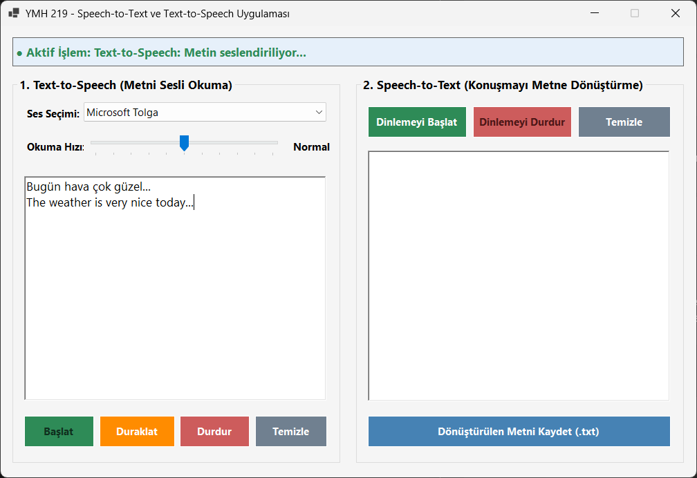
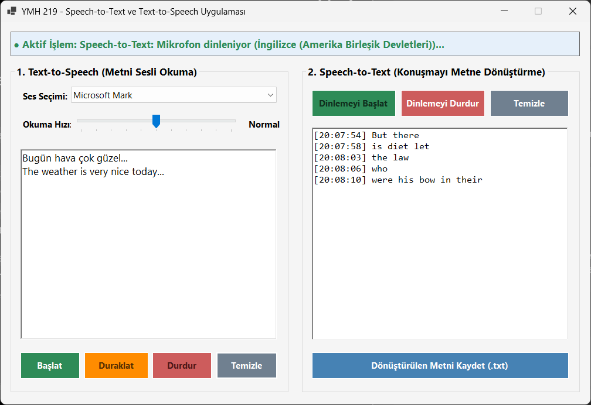
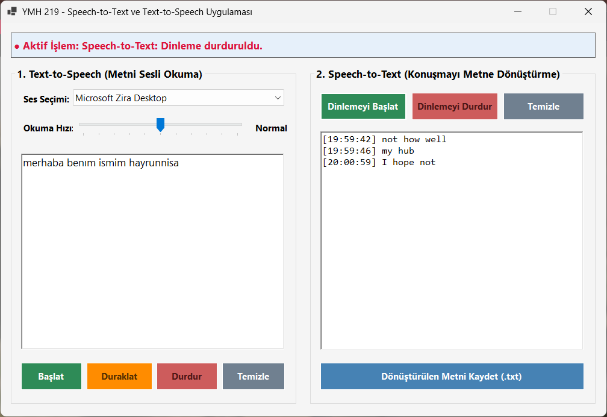

# YMH 219 - Speech-to-Text ve Text-to-Speech Uygulaması

* **Öğrenci Adı Soyadı:** Hayrunnisa Ekinci
* **Öğrenci Numarası:** 240541043
* **Ders:** YMH 219 - Nesne Tabanlı Programlama

## Proje Hakkında

Bu proje, C# Windows Forms (.NET 10.0) ve `System.Speech` kütüphanesi kullanılarak geliştirilmiş; yazılı metni sesli olarak okuyan (**Text-to-Speech**) ve mikrofondan alınan konuşmayı zaman damgalı metne dönüştüren (**Speech-to-Text**) nesne yönelimli bir masaüstü uygulamasıdır.

## Kullanılan Teknoloji ve Kütüphaneler

* **Programlama Dili:** C#
* **Arayüz Çatısı:** Windows Forms (.NET 10.0)
* **Konuşma Sentezi & Tanıma (NuGet):** `System.Speech` (`SpeechSynthesizer`, `SpeechRecognitionEngine`) ve `System.IO` (`StreamWriter`) — `System.Speech` NuGet paketi kullanılmıştır.

## Uygulamanın Temel Özellikleri

* **Text-to-Speech Servisi (`TextToSpeechService` Sınıfı):** `SpeechSynthesizer` bileşenini kapsüller; sistemde yüklü ses profillerini (`Microsoft Tolga`, `Microsoft Mark`, `Microsoft Zira Desktop` vb.) listeleme, konuşma hızı ayarı (`-10` ile `+10` arası), asenkron seslendirme (`SpeakAsync`), duraklatma/devam ettirme, durdurma ve `IDisposable` kaynak temizliği sağlar.
* **Speech-to-Text Servisi (`SpeechToTextService` Sınıfı):** `SpeechRecognitionEngine` altyapısını kapsüller; mikrofon ses girişini sürekli dinleme modunda (`RecognizeMode.Multiple`) işler, tanınan konuşmaları olay tabanlı (`Action<string>`) olarak arayüze iletir ve donanım/servis hatalarını güvenli biçimde yakalar.
* **Canlı İşlem Durumu Göstergesi:** Arayüzün üst bölümünde aktif çalışan mod (Seslendirme, Duraklatıldı, Mikrofon Dinleniyor, Dinleme Durduruldu, Hata) renk kodlu durum çubuğuyla anlık gösterilir.
* **Zaman Damgası ve Dosya Dışa Aktarımı:** Konuşma tanıma sonuçları `[HH:mm:ss]` saat bilgisiyle listelenir ve tek tıkla `.txt` dosyası olarak dışa aktarılabilir.

## Ekran Görüntüleri

### 1. Text-to-Speech (Metni Sesli Okuma) Aktif Seslendirme Görünümü

### 2. Speech-to-Text (Konuşmayı Metne Dönüştürme) Canlı Dinleme Görünümü

### 3. Dinleme Durduruldu Durumu ve Zaman Damgalı Metin Çıktısı Görünümü

## Bilinen Sınırlamalar ve Geliştirme Notları

* Masaüstü `.NET System.Speech` (SAPI 5) altyapısı Windows işletim sisteminde yüklü olan yerel dil ve ses paketlerine bağlıdır; Türkçe konuşma tanıma paketi Windows masaüstü SAPI motorunda yerleşik bulunmadığından İngilizce (`en-US`) tanıma modeli kullanılmaktadır.
* Mikrofon donanımı bulunmayan veya ses hizmeti devre dışı olan sistemlerde konuşma tanıma özelliği çalışmaz ve kullanıcıya hata uyarısı gösterilir.

## Kurulum ve Çalıştırma Adımları

1. **Depoyu Bilgisayarınıza İndirin (Clone):**
   - Terminal veya PowerShell üzerinde `git clone https://github.com/eknchayru403-afk/YMH219-SpeechApp.git` komutunu çalıştırın.
   - Alternatif olarak GitHub sayfasında sağ üstteki **Code** -> **Download ZIP** seçeneğiyle projeyi arşiv olarak indirip klasöre çıkartın.

2. **Visual Studio ile Açın:**
   - İndirdiğiniz klasörün içindeki `YMH219-SpeechApp.csproj` (veya `.slnx`) dosyasına çift tıklayarak projeyi **Visual Studio 2026** (.NET 10.0) ile açın.

3. **NuGet Paketini Geri Yükleyin ve Derleyin:**
   - Proje `System.Speech` NuGet paketini kullanmaktadır; derleme sırasında Visual Studio paketi otomatik geri yükler (gerekirse **Çözüme Sağ Tık -> NuGet Paketlerini Geri Yükle** seçin).
   - Üst menüden **Derle -> Çözümü Derle** (`Ctrl + Shift + B`) seçeneğiyle projenin hatasız derlendiğini doğrulayın.

4. **Uygulamayı Başlatın:**
   - Üst araç çubuğundaki yeşil **Başlat** butonuna tıklayın veya klavyeden **`F5`** tuşuna basın; sol panelden metin seslendirmeyi, sağ panelden mikrofon ile konuşma tanımayı test edin.
